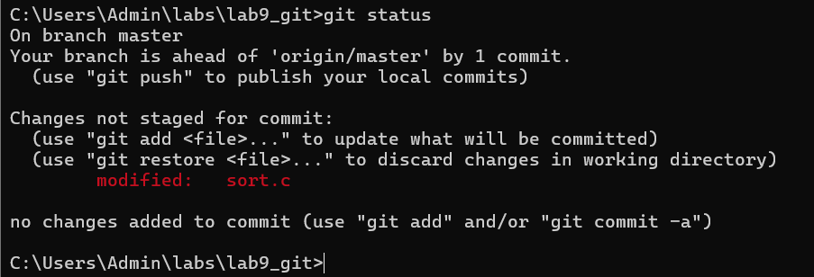
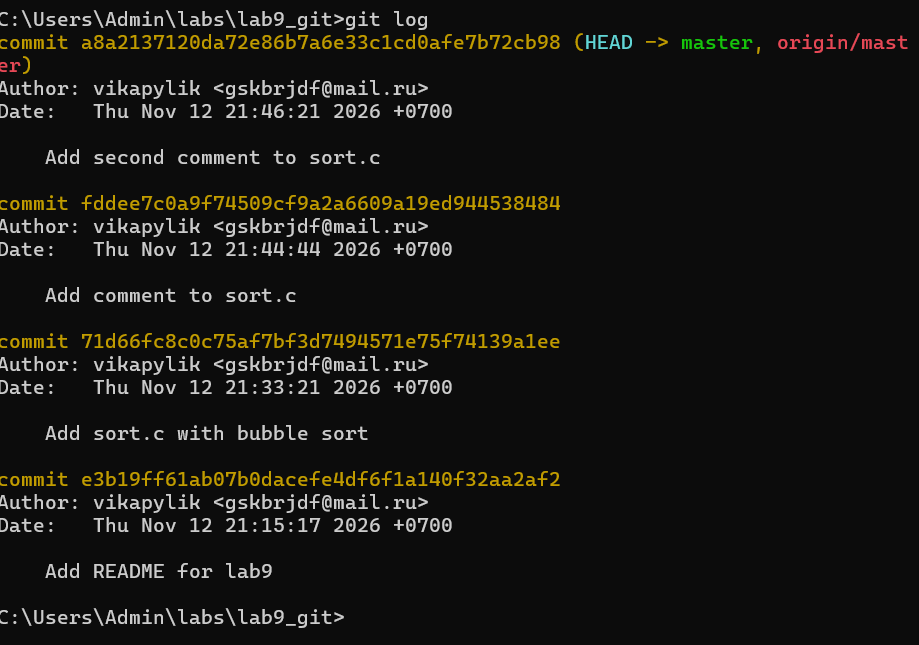
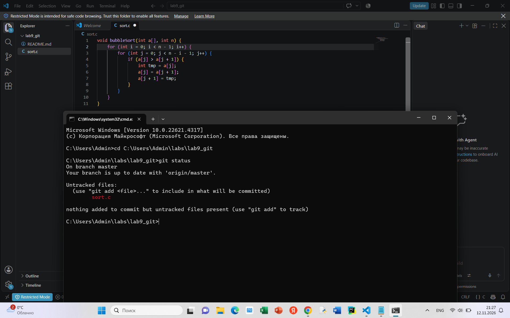
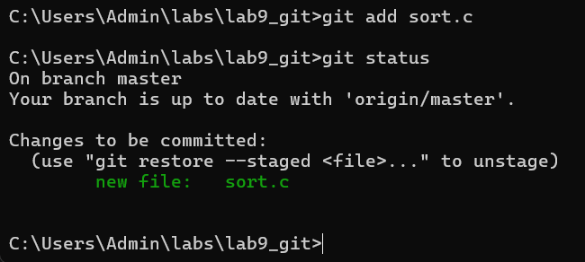
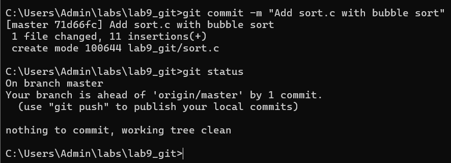
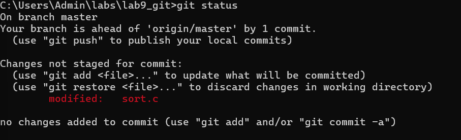
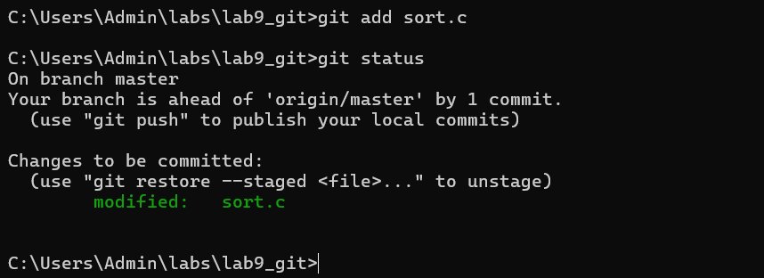
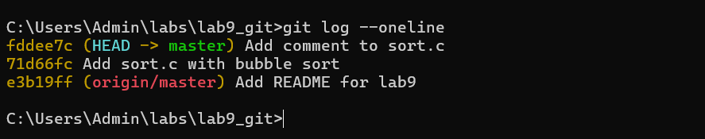
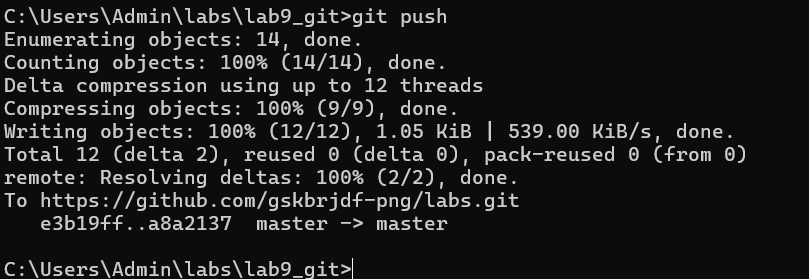

# Практическое задание 9. Git

## Оценка 3

### Шаг 1. git status

Находимся на ветке master.

### Шаг 2. git log (вместо этого скриншота можно взять тот, где полный git log)

Вывод журнала коммитов.

### Шаг 3. Создание файла sort.c

Создан файл sort.c, содержащий функцию пузырьковой сортировки.

### Шаг 4. git status (после создания)

Файл sort.c появился в разделе Untracked (красный), Git его видит, но еще не отслеживает.

### Шаг 5 и 6. Добавление в stage (git add) и status

После команды git add файл переместился в Changes to be committed (зеленый).

### Шаг 7 и 8. Первый коммит и status

Файл закоммичен, рабочая директория чиста (nothing to commit).

### Шаг 9 и 10. Изменение файла и status

В файл sort.c добавлен комментарий. Git заметил изменения (файл снова красный, modified).

### Шаг 11 и 12. Добавление изменения (add) и status

Изменение добавлено в stage (файл зеленый, modified).

### Шаг 13, 14, 15. Коммит и журнал

Сделан коммит. В git log --oneline видны два новых коммита (Add sort.c и Add comment).

### Шаг 16. Финальный коммит

Последние изменения закоммичены.

### Шаг 17. Отправка на GitHub (git push)

Все локальные изменения успешно отправлены на удаленный репозиторий GitHub.